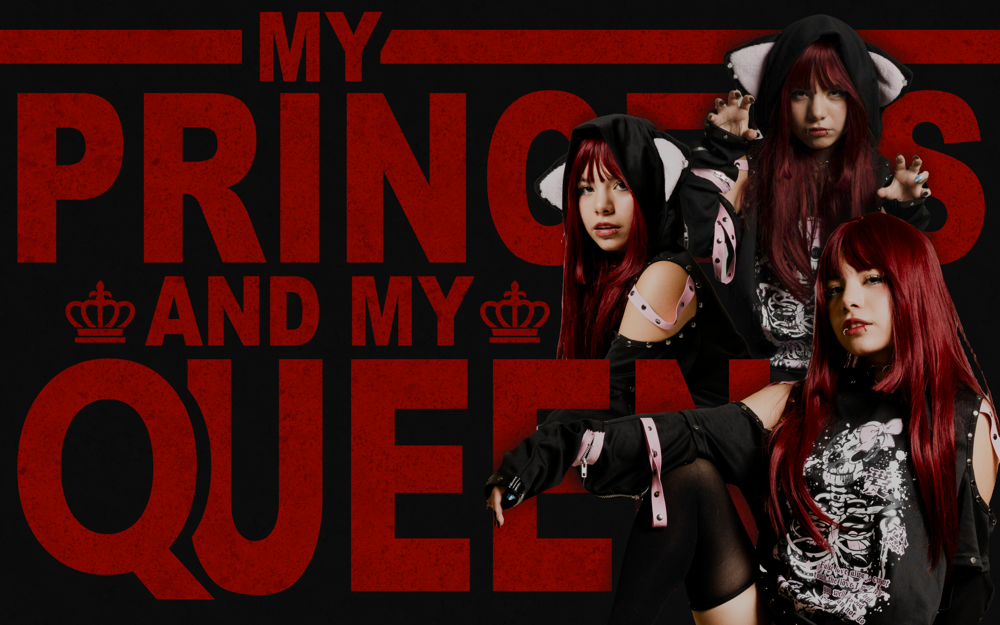

# 🔴 RedRice-Arch

A sleek, cohesive **Crimson Glass** Arch Linux rice built on top of **Hyprland**, featuring a custom Z-axis workspace stacking plugin, animated Waybar capsule/pill dual-mode, live countdown notification proxies, smooth cross-fade wallpaper transitions, translucent terminal effects, and bespoke C++ Qt skinning for Dolphin.



---

## 🌟 Highlights & Features

| Component | Tool / Tech | Highlights |
| :--- | :--- | :--- |
| **Window Manager** | **Hyprland** | Fractional scaling (1.33×), 35px aggressive rounding, custom `hypr-zstack` plugin (Z-axis 3-workspace stack), floating `special:cmd` scratchpad, right-click-on-desktop launcher trigger |
| **WM Plugin** | **hypr-zstack** | Custom C++ Hyprland plugin: workspaces stack on Z-axis, slide-in on forward switch, slide-away on back, strict input isolation for background workspaces |
| **Status Bar** | **Waybar** | Dual-mode: **Main** (vertical full bar) and **Capsule** (minimal clock-only); Super-hold >2s reveals floating **Pill** workspace switcher; dynamic per-workspace app icons |
| **Notifications** | **SwayNC** | Custom DBus countdown proxy (`swaync_proxy.py`), GResource UI overlay (`notification.ui`), crimson-accented with live progress bar, `libswaync_helper.so` |
| **Terminal** | **Kitty** | Crimson beam cursor, animated cursor trail (`cursor_trail`), 40% background transparency, Kitty SSH integration (`kitten ssh`) |
| **App Launcher** | **Wofi** | Crimson glass style, blur via Hyprland `layerrule`, slide-left animation, left-gradient search bar, crimson accent entry selection |
| **File Manager** | **Dolphin** | **Crimson Glass Edition**: custom C++ palette hook (`libdolphinglass.so`) injected via `LD_PRELOAD`, matching QSS stylesheet, `CrimsonGlass.colors` KDE color scheme |
| **Login Manager** | **SDDM** | `sddm-astronaut-theme` with matching wallpaper, blur, and virtual keyboard (`qt6-virtualkeyboard`) |
| **Code Editor** | **Antigravity IDE** | Custom transparency rule (92% active / 85% inactive) |
| **Notes** | **Obsidian** | Near-opaque rule (99%) with compositor blur pass-through |
| **Discord** | **Vesktop + Vencord** | ClearVision V7 theme configured to custom wallpaper background, crimson danger colors, 30% shading |
| **Text Editor** | **Neovim** | Catppuccin Mocha (transparent), GitHub Copilot, NvimTree, Treesitter, Gitsigns, Bufferline, colorizer |
| **Cloud Sync** | **rclone** | Auto-mounted Google Drive at `~/drive/` on Hyprland startup |
| **Power / Hardware** | **Udev / TLP / Systemd** | Udev rules to suppress accidental wakeups from Logitech mice and ASUS touchpad; TLP for battery management; zram swap generator |
| **Screen Capture** | **hyprshot / hyprpicker** | Region screenshot (`Super+H`), color picker (`Super+P`) |
| **Wallpaper** | **hyprpaper + switch-wallpaper.py** | Butter-smooth cross-fade GTK overlay transition between wallpapers on all monitors simultaneously |
| **Shell** | **Bash** | zoxide, NVM, SDKMAN, `redrice-sync` git helper, Kitty SSH integration |

---

## 🎨 Colour Palette — Crimson Glass

| Role | Hex / Value |
|:---|:---|
| **Active border / accent** | `#710400` → `#000000` (45° gradient) |
| **Deep crimson accent** | `#710400` |
| **Bright crimson highlight** | `#ff3333` |
| **Lime green (CPU / Waybar accent)** | `#ABFF24` |
| **Soft pink (notification progress)** | `#FFA5A5` |
| **Background (Waybar / notifications)** | `rgba(0,0,0,0.70)` |
| **Terminal transparency** | 40% opacity |
| **Rounding radius** | 35 px (`rounding_power = 1`) |
| **Font (bar)** | JetBrainsMono Nerd Font Propo |
| **Font (launcher / UI)** | gg sans / Inter |

---

## 📁 Repository Structure

```
RedRice-Arch/
├── install.sh                          # Automated modular installer
├── packages/
│   ├── pkglist-repo.txt                # Official Arch repository packages
│   ├── pkglist-aur.txt                 # AUR packages (yay)
│   ├── services-system.txt             # Enabled systemd system services
│   └── services-user.txt               # Enabled systemd user services
├── dot_config/                         # Configurations mapped to ~/.config/
│   ├── hypr/
│   │   ├── hyprland.conf               # Main Hyprland config
│   │   ├── hyprpaper.conf              # Wallpaper assignments per monitor
│   │   ├── hyprland.lua                # Lua scripting entrypoint
│   │   ├── plugins/hypr-zstack/        # Custom C++ Z-axis workspace plugin
│   │   │   ├── src/main.cpp            # Plugin source
│   │   │   ├── hypr-zstack.so          # Compiled plugin (Hyprland v5)
│   │   │   └── Makefile
│   │   ├── scripts/
│   │   │   ├── switch-wallpaper.py     # Smooth cross-fade wallpaper switcher (GTK overlay)
│   │   │   └── toggle-dnd.sh           # SwayNC DND toggle with on-screen feedback
│   │   └── Wallpapers/                 # wallpaper1.png, wallpaper2.png, wallpaper1.jpg
│   ├── waybar/
│   │   ├── config.jsonc                # Active config (symlinked from main/capsule)
│   │   ├── config-main.jsonc           # Full vertical bar mode
│   │   ├── config-capsule.jsonc        # Minimal clock-capsule mode
│   │   ├── modules.json                # All module definitions (shared)
│   │   ├── style.css                   # Main stylesheet
│   │   ├── colors.css                  # CSS variables (Crimson Glass palette)
│   │   ├── audio-state.css             # Audio boost state styles
│   │   ├── workspaces-pill.css         # Floating pill workspace overlay styles
│   │   ├── .current_mode               # Tracks active mode: "main" or "capsule"
│   │   ├── *_menu.xml                  # GTK menus: power, network, BT, audio, mic
│   │   └── scripts/
│   │       ├── toggle-capsule.sh/.py   # Switch between main ↔ capsule mode
│   │       ├── workspaces-pill.py      # Super-hold pill controller
│   │       ├── workspace-icons.py      # Per-workspace app icon generator
│   │       ├── hypr-scale.sh           # Live monitor DPI scale switcher (0.75/1.0/1.33/1.5×)
│   │       ├── audio-output.sh         # Audio output selector (fzf)
│   │       ├── audio-input.sh          # Mic input selector (fzf)
│   │       ├── audio-boost.sh          # Audio boost toggle
│   │       ├── bt-connect.sh           # Bluetooth device connector (fzf)
│   │       └── wifi-connect.sh         # Wi-Fi network connector (nmcli + fzf)
│   ├── swaync/
│   │   ├── config.json                 # SwayNC daemon config
│   │   ├── style.css                   # Crimson Glass notification styles
│   │   ├── notification.ui             # GResource UI overlay definition
│   │   ├── swaync_proxy.py             # DBus countdown proxy (animates live progress bar)
│   │   ├── swaync_helper.c             # C helper source for GResource injection
│   │   ├── Makefile                    # Build libswaync_helper.so
│   │   └── libswaync_helper.so         # Compiled shared library
│   ├── kitty/
│   │   └── kitty.conf                  # 40% transparency, crimson beam cursor, cursor trail
│   ├── wofi/
│   │   ├── config                      # Wofi settings
│   │   └── style.css                   # Crimson Glass launcher stylesheet
│   ├── dolphin/
│   │   ├── dolphinglass.cpp            # C++ Qt6 palette hook source
│   │   └── dolphin-glass.qss           # Qt stylesheet
│   ├── nvim/
│   │   └── init.vim                    # Catppuccin Mocha + Copilot + NvimTree + Treesitter
│   ├── eww/
│   │   └── eww.yuck                    # EWW widget definitions (Wayland layer surface)
│   ├── quickshell/hyprquickshot/       # QML screenshot tool (region/window/screen)
│   ├── vesktop/
│   │   ├── settings.json               # Vesktop app settings
│   │   ├── settings/
│   │   │   ├── settings.json           # Vencord plugin settings
│   │   │   ├── native-settings.json    # Native Vesktop settings
│   │   │   └── quickCss.css            # ClearVision V7 theme + crimson customizations
│   │   └── themes/                     # ClearVision V7 and RadialStatus themes
│   ├── systemd/user/
│   │   ├── swaync-proxy.service        # Autostart swaync_proxy.py
│   │   └── swaync.service.d/override.conf
│   └── kdeglobals                      # CrimsonGlass KDE color scheme assignment
├── dot_local/                          # Mapped to ~/.local/
│   ├── bin/
│   │   ├── dolphin                     # Crimson Glass wrapper (LD_PRELOAD injector)
│   │   └── setup-suspend-wakeup.sh     # Udev suspend wakeup configuration helper
│   ├── lib/
│   │   └── libdolphinglass.so          # Compiled Dolphin Qt6 palette hook
│   └── share/color-schemes/
│       └── CrimsonGlass.colors         # KDE colour scheme file
├── system/                             # System configurations mapped to /etc/
│   ├── sddm/
│   │   ├── sddm.conf                   # SDDM config
│   │   ├── virtualkbd.conf             # Virtual keyboard for SDDM
│   │   └── purple_leaves.conf          # Astronaut theme variant config
│   ├── udev/
│   │   └── 90-disable-mouse-wakeup.rules  # Suppress Logitech + ASUS touchpad wakeup
│   ├── grub                            # (gitignored) /etc/default/grub — machine-specific, bring your own
│   ├── grub.d/40_custom                # (gitignored) custom GRUB entry — contains filesystem UUID
│   ├── mkinitcpio.conf                 # (gitignored) hooks + modules — machine-specific
│   └── linux.preset                    # (gitignored) mkinitcpio preset — machine-specific
└── shell/                              # User shell configuration
    ├── .bashrc                         # Aliases, zoxide, NVM, SDKMAN, redrice-sync
    ├── .bash_profile
    └── commands/                       # Quick cheatsheets
        ├── BluetoothCommands.txt
        ├── WifiCommands.txt
        ├── Storage.txt
        ├── ProgramCreation.txt
        ├── Fun.txt
        └── zip.txt
```

---

## 🚀 Quick Start / Installation

### Prerequisites

- A fresh or existing **Arch Linux** install
- An internet connection
- `base-devel` and `git` available (the installer will ensure these)

### 1. Clone the Repository

```bash
git clone git@github.com:GianUwU/RedRice-Arch.git ~/RedRice-Arch
cd ~/RedRice-Arch
```

### 2. Run the Installer

```bash
chmod +x install.sh
./install.sh
```

The installer will interactively prompt before each step and supports both **symlink** (live) and **copy** deployment modes:

| Step | What it does |
|:---|:---|
| **1. Official packages** | Installs from `packages/pkglist-repo.txt` via `pacman` |
| **2. AUR packages** | Installs from `packages/pkglist-aur.txt` via `yay` (auto-installs yay if missing) |
| **3. Dotfiles** | Deploys `dot_config/` → `~/.config/` with path substitution for your user |
| **4. Local assets** | Deploys `dot_local/` → `~/.local/` (binaries, `libdolphinglass.so`, color schemes) |
| **5. Shell config** | Deploys `.bashrc`, `.bash_profile`, `Commands/` cheatsheets |
| **6. SDDM** | Configures SDDM (`sddm.conf` + `virtualkbd.conf`), clones `sddm-astronaut-theme`, installs `purple_leaves.conf` variant + wallpaper, enables `sddm.service` |
| **7. Udev rules** | Disables Logitech mouse + ASUS touchpad wakeup-from-suspend |
| **8. Services** | Enables `NetworkManager`, `bluetooth`, `sddm`, `swaync-proxy`, `swaync`, `wireplumber` |
| **9. GRUB** | *(optional — gitignored, bring your own)* Copies `system/grub` → `/etc/default/grub` if present, copies `40_custom`, runs `grub-mkconfig` |
| **10. mkinitcpio** | *(optional — gitignored, bring your own)* Copies `system/mkinitcpio.conf` + `linux.preset` if present, always runs `mkinitcpio -P` |
| **11. Secure Boot** | Runs `sbctl` — creates keys (if in Setup Mode), enrols with Microsoft keys, registers + signs all EFI binaries, runs `sbctl sign-all -g` |

> **Note:** After installation, reboot or restart your Wayland session. If you use the symlink deploy mode, any future changes to the repo are immediately live.

---

## 🔌 Custom Plugins & Compiled Components

### hypr-zstack (Hyprland Plugin)

Custom C++ Hyprland plugin implementing **Z-axis workspace stacking**:

- Workspaces stack visually behind each other (up to 3 deep)
- Forward switch: new workspace **slides in on top**
- Back switch: top workspace **slides away**, revealing the workspace below
- Background workspaces are **strictly non-interactable** (input isolation)
- Full transparency/blur support — no compositor wallpaper X-ray culling

**Build from source:**
```bash
cd ~/.config/hypr/plugins/hypr-zstack
make
```

**Load/Unload manually:**
```bash
hyprctl plugin load ~/.config/hypr/plugins/hypr-zstack/hypr-zstack.so
hyprctl plugin unload ~/.config/hypr/plugins/hypr-zstack/hypr-zstack.so
```

**Remove workspace from stack:**
```
Super + Alt + [1-9]   zstack:remove for workspace N
```

### Dolphin Crimson Glass (C++ Qt6 Hook)

A shared library injected via `LD_PRELOAD` that patches the Qt6 QPalette at runtime, applying the full Crimson Glass colour scheme to Dolphin without modifying upstream Qt or KDE packages.

**Recompile if needed:**
```bash
cd ~/.config/dolphin
g++ -shared -fPIC -O3 dolphinglass.cpp -o ~/.local/lib/libdolphinglass.so \
    $(pkg-config --cflags --libs Qt6Widgets)
```

### SwayNC Notification Proxy

A Python DBus proxy (`swaync_proxy.py`) that sits between application notification senders and SwayNC. For timed notifications, it drives a live animated countdown progress bar by periodically re-sending the notification with an updated `value` hint (0–100). This gives every notification a real-time expiry indicator.

Runs as a user systemd service: `swaync-proxy.service`

---

## ⌨️ Keybindings Reference

### Applications

| Binding | Action |
|:---|:---|
| `Super + Q` | Launch Kitty terminal |
| `Super + Tab` | Toggle `special:cmd` scratchpad (floating terminal) |
| `Super + A` | Open Vivaldi browser (new window) |
| `Super + D` | Launch Vesktop (Discord) |
| `Super + C` | Launch Antigravity IDE |
| `Super + S` | Launch Steam |
| `Super + O` | Launch Obsidian |
| `Super + L` | Launch OnlyOffice |
| `Super + T` | Open Microsoft Teams in Vivaldi |
| `Super + N` | Open OneNote in Vivaldi |
| `Super + E` | Open Dolphin (Crimson Glass) file manager |
| `Super + H` | Screenshot region → `~/Documents/Screenshots` (hyprshot) |
| `Super + P` | Color picker (hyprpicker, copies to clipboard) |
| `Super + Space` / `Super + §` | App launcher (Wofi) |

### Window Management

| Binding | Action |
|:---|:---|
| `Super + W` | Kill active window |
| `Super + V` | Toggle floating |
| `Super + G` | Toggle pseudo-tiling (dwindle) |
| `Super + J` | Toggle split direction (dwindle) |
| `Super + ←/→/↑/↓` | Move focus |
| `Super + [1-9]` | Switch workspace |
| `Super + Shift + [1-9]` | Move window to workspace |
| `Super + 0` | Toggle `special:magic` workspace |
| `Super + Alt + [1-9]` | Remove workspace N from Z-stack |
| `Super + Scroll` | Cycle workspaces |
| `Super + LMB drag` | Move window |
| `Super + RMB drag` | Resize window |
| `RMB on empty desktop` | Open Wofi launcher |

### Media & Hardware

| Binding | Action |
|:---|:---|
| `XF86AudioRaiseVolume` | Volume +5% |
| `XF86AudioLowerVolume` | Volume −5% |
| `XF86AudioMute` | Toggle mute |
| `XF86AudioMicMute` | Toggle mic mute |
| `XF86MonBrightnessUp/Down` | Brightness ±5% |
| `XF86AudioNext/Prev/Play/Pause` | Playerctl media controls |

### Waybar & UI

| Binding / Action | Effect |
|:---|:---|
| **Hold Super >2s** | Temporarily show floating workspaces pill |
| **Right-click clock** | Toggle Capsule ↔ Main bar mode |
| **Click wallpaper/scale icon** | Cross-fade to next wallpaper |
| `Super + N` (SwayNC) | Open notification panel |

---

## 🖥️ Waybar Modes

### Main Mode (default)
Full vertical bar on the right edge with: clock, CPU meter, workspaces, tray, mic, audio, brightness, DPI scale switcher, battery, power menu.

### Capsule Mode
Minimal — shows only a floating clock capsule in the top-right corner, taking up almost no screen space.

### Pill Mode (transient)
Activated by holding `Super` for >2 seconds in capsule mode. A floating workspace indicator with per-workspace app icons slides in, then auto-hides on Super release.

**Toggle manually:**
```bash
~/.config/waybar/scripts/toggle-capsule.sh
```

---

## 🖥️ Monitor Scaling

The bar includes a live **DPI scale switcher** drawer. Click the current scale label to expand and pick:

| Scale | Label |
|:---|:---|
| 0.75× | `0.75` |
| 1.00× | `1.0` |
| 1.33× | `1.33` ← default |
| 1.50× | `1.5` |

Scaling is applied live via `hyprctl` and wallpapers are automatically reapplied across all monitors.

---

## 🌅 Wallpaper Switcher

```bash
~/.config/hypr/scripts/switch-wallpaper.py        # Toggle to next wallpaper
~/.config/hypr/scripts/switch-wallpaper.py /path  # Switch to specific image
~/.config/hypr/scripts/switch-wallpaper.py --status  # JSON status for Waybar
```

Performs a butter-smooth cross-fade transition using a fullscreen GTK layer-shell overlay on every active monitor simultaneously. Supports any `.png`, `.jpg`, `.jpeg`, `.webp` files in `~/.config/hypr/Wallpapers/`.

---

## 🔔 Notifications

SwayNC is configured with:
- Crimson-bordered, semi-transparent notification popups
- Crimson close button, flush left-aligned
- Live animated countdown progress bar (lime → pink gradient) driven by the custom DBus proxy
- Right-side positioning, `12px` top/bottom margin, `18px` right inset
- Do-Not-Disturb toggle with on-screen feedback:

```bash
~/.config/hypr/scripts/toggle-dnd.sh
```

---

## 💬 Discord (Vesktop)

Vesktop with Vencord uses **ClearVision V7** themed to match the rice:
- Background: custom wallpaper image hosted at `gian.ink`
- 30% background shading (semi-transparent panels)
- Danger / DND colour: `#982929` (crimson)
- RadialStatus plugin for circular status indicators

---

## 🛠️ Shell Utilities

### redrice-sync
Quick git commit & push shortcut for updating the rice:
```bash
redrice-sync "my update message"
# defaults to "Rice update YYYY-MM-DD HH:MM" if no message given
```

### Kitty SSH Integration
Automatically uses `kitten ssh` to push terminfo to remote hosts, so the full Kitty experience works over SSH:
```bash
ssh user@host   # auto-aliases to kitten ssh when inside Kitty
```

---

## ⚙️ System Services

### System (via systemctl)

| Service | Purpose |
|:---|:---|
| `NetworkManager.service` | Network management |
| `bluetooth.service` | Bluetooth stack |
| `sddm.service` | Display / login manager |
| `sshd.service` | SSH daemon |
| `tlp.service` | Battery / power optimisation |
| `docker.socket` | Docker on-demand |
| `mariadb.service` | Local MariaDB server |
| `fstrim.timer` | Weekly SSD trim |
| `paccache.timer` | Weekly pacman cache cleanup |

### User (via systemctl --user)

| Service | Purpose |
|:---|:---|
| `swaync.service` | Notification daemon |
| `swaync-proxy.service` | DBus countdown notification proxy |
| `wireplumber.service` | PipeWire session manager |
| `pipewire.socket` | PipeWire audio |
| `pipewire-pulse.socket` | PulseAudio compatibility |
| `ssh-agent.socket` | SSH agent |

---

## 🎨 Manual Compilation

### Dolphin Crimson Glass
```bash
cd ~/.config/dolphin
g++ -shared -fPIC -O3 dolphinglass.cpp -o ~/.local/lib/libdolphinglass.so \
    $(pkg-config --cflags --libs Qt6Widgets)
```

### hypr-zstack Plugin
```bash
cd ~/.config/hypr/plugins/hypr-zstack
make
```

### SwayNC Helper
```bash
cd ~/.config/swaync
make
```

---

## 🔐 Secure Boot & Boot Chain

This setup uses **GRUB + sbctl** for a fully signed, Secure-Boot-ready boot chain on Arch Linux.

### Boot Chain Overview

```
UEFI Firmware
  └─ GRUB (grubx64.efi) — signed by sbctl custom keys
       └─ vmlinuz-linux + initramfs-linux.img
            └─ systemd-based initrd → ext4 rootfs
```

### Key Tools

| Tool | Role |
|:---|:---|
| **GRUB** | Bootloader, Tela graphical theme, 3s timeout |
| **sbctl** | Secure Boot key manager — creates/enrols custom Platform Key |
| **mkinitcpio** | Initramfs builder with systemd hooks |
| **os-prober** | Disabled (dual-boot suppressed by default) |

### sbctl — Automatic EFI Signing

`sbctl` ships a **pacman hook** (`zz-sbctl.hook`) that automatically runs after every kernel or EFI-touching package update:

```
Generating EFI bundles...
✓ Signed /usr/lib/systemd/boot/efi/systemd-bootx64.efi.signed
✓ Signed /boot/EFI/GRUB/grubx64.efi
✓ Signed /boot/vmlinuz-linux
...
```

This means any `pacman -Syu` that updates the kernel, GRUB, or systemd **automatically re-signs all registered EFI binaries** — no manual step required.

### Initial Secure Boot Setup

> **Do this once** after first boot with Secure Boot in Setup Mode:

```bash
# 1. Enter UEFI Setup Mode (clear existing keys in firmware settings)

# 2. Create sbctl Secure Boot keys
sudo sbctl create-keys

# 3. Enrol keys (keeping Microsoft keys for hardware compatibility)
sudo sbctl enrol-keys -m

# 4. Register all EFI binaries to be signed
sudo sbctl sign -s /boot/EFI/GRUB/grubx64.efi
sudo sbctl sign -s /boot/EFI/BOOT/BOOTX64.EFI
sudo sbctl sign -s /boot/vmlinuz-linux
sudo sbctl sign -s /usr/lib/systemd/boot/efi/systemd-bootx64.efi

# 5. Trigger a full re-sign (also done automatically on future updates)
sudo sbctl sign-all -g

# 6. Verify all registered files are signed
sbctl verify

# 7. Enable Secure Boot in firmware settings and reboot
```

### Check Current Status

```bash
sbctl status          # Setup Mode, Secure Boot on/off, vendor keys
sbctl list-files      # All registered EFI files and their signed state
sbctl verify          # Verify signatures on all files in /boot
```

### mkinitcpio Configuration

**`/etc/mkinitcpio.conf`** — stored in `system/mkinitcpio.conf`:

```bash
MODULES=(vmd nvme ext4)      # NVMe + VMD RAID + ext4 built into initrd
HOOKS=(base udev systemd autodetect microcode modconf kms keyboard keymap sd-vconsole block filesystems fsck)
```

Regenerate initramfs after changes:
```bash
sudo mkinitcpio -P
```

> `sbctl sign-all -g` runs automatically afterwards via the pacman hook.

### GRUB Configuration

**`/etc/default/grub`** — stored in `system/grub`:

```bash
GRUB_CMDLINE_LINUX_DEFAULT="loglevel=3 quiet acpi_osi=\"!Windows 2020\""
GRUB_CMDLINE_LINUX="zswap.enabled=0 rootfstype=ext4"
GRUB_THEME="/usr/share/grub/themes/tela/theme.txt"
GRUB_GFXMODE=1920x1080,auto
GRUB_TIMEOUT=3
GRUB_DISABLE_OS_PROBER=true      # Windows dual-boot suppressed
```

Key notes:
- `acpi_osi="!Windows 2020"` — ACPI quirk to fix ASUS BIOS behaviour
- `zswap.enabled=0` — disabled in favour of **zram** (`zram-generator`)
- `GRUB_THEME=tela` — graphical Tela theme for GRUB menu

Regenerate GRUB config after changes:
```bash
sudo grub-mkconfig -o /boot/grub/grub.cfg
```

### Custom GRUB Entry — GParted Live (ISO loopback)

A custom GRUB menu entry in `system/grub.d/40_custom` boots **GParted Live** directly from an ISO stored on the filesystem — no USB needed:

```bash
# Place the ISO on your root partition:
sudo cp gparted-live-*.iso /gparted-live.iso

# Then regenerate GRUB config:
sudo grub-mkconfig -o /boot/grub/grub.cfg
```

### zram Swap

This system uses **zram** instead of a traditional swap partition or zswap:

```bash
# zram-generator is installed; config is at /etc/systemd/zram-generator.conf
# Check zram status:
zramctl
```
